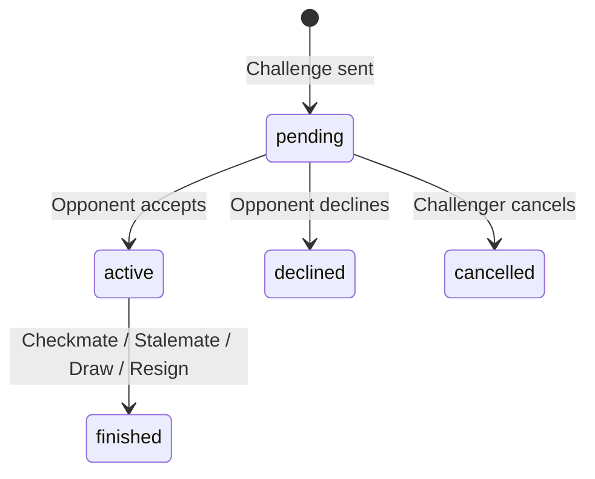
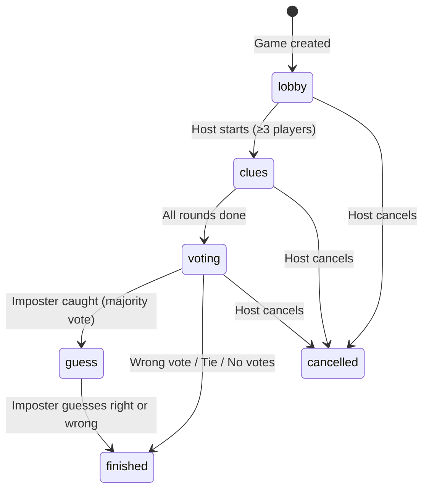
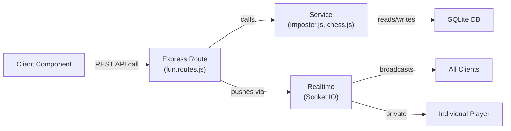

# 🕵️ BubbleUp Games Analysis & Imposter Feature Guide

## Table of Contents
1. [Complete Games Analysis](#1-complete-games-analysis)
2. [Imposter Game Deep Dive](#2-imposter-game-deep-dive)
3. [Feature Roadmap: Adding New Features to Imposter](#3-feature-roadmap)
4. [Step-by-Step Implementation Guides](#4-step-by-step-implementation-guides)

---

## 1. Complete Games Analysis

BubbleUp has **four interactive "fun" features** embedded in its classroom chat. Each follows the same architecture: a **server service** (business logic + DB), a **REST route** (HTTP API), **realtime events** (Socket.IO push), and **React components** (card in chat + full modal).

### 1.1 Chess ♟️

| Aspect | Details |
|---|---|
| **Type** | 1v1 turn-based board game |
| **Players** | Exactly 2 (white & black, randomly assigned) |
| **Flow** | Challenge → Accept/Decline → Play moves → Checkmate/Draw/Resign |
| **Server validation** | Every move validated by `chess.js` library |
| **DB table** | `chess_games` (migration v2) |
| **Statuses** | `pending` → `active` → `finished` / `declined` / `cancelled` |
| **Realtime** | `chess:update` broadcast to channel on every action |
| **Client components** | `ChessCard.jsx` (in-chat), `ChessBoard.jsx` (interactive board), `ChessModal.jsx` (full game), `pieces.jsx` (SVG pieces) |
| **Slash command** | `/chess @username` |
| **Features** | Drag & drop, click-to-move, promotion dialog, move history, flip board, resign with confirmation, spectator mode |



### 1.2 Imposter 🕵️

| Aspect | Details |
|---|---|
| **Type** | Multiplayer social deduction word game |
| **Players** | 3–10 |
| **Flow** | Lobby → Clues (2 rounds) → Vote → Guess (if caught) → Finished |
| **Modes** | Random word (host plays) or Custom word (host runs the game) |
| **DB table** | `imposter_games` (migration v3) |
| **Statuses** | `lobby` → `clues` → `voting` → `guess` → `finished` / `cancelled` |
| **Realtime** | `imposter:update` (public), `imposter:secret` (per-player), `imposter:watchers` (live audience) |
| **Client components** | `ImposterCard.jsx` (in-chat), `ImposterCreateModal.jsx` (new game), `ImposterModal.jsx` (full game) |
| **Slash command** | `/imposter [category]` |
| **Categories** | Animals, Food, School, Places, Sports, Jobs, At home, Nature (8 built-in, 15 words each) |



### 1.3 Random Picker 🎯

| Aspect | Details |
|---|---|
| **Type** | Spinner wheel (single-use, no persistent game state) |
| **Players** | N/A — picks from options or class students |
| **Flow** | `/pick` → Bot posts a reply with wheel metadata → Client animates the spin |
| **DB** | No game table — uses `messages.meta` with `type: "pick"` |
| **Client component** | `PickWheel.jsx` (SVG animated wheel) |
| **Slash command** | `/pick [a, b, c]` or `/pick` (class students) |

### 1.4 Weekly Awards 🏆

| Aspect | Details |
|---|---|
| **Type** | Automated weekly stats (not a game) |
| **Categories** | Chatterbox, Most helpful, Crowd favourite, Emoji champion, Question master, Night owl, Poll enthusiast |
| **Flow** | Auto-posts Fridays or via `/awards` (preview for students, public for teachers) |
| **DB** | `class_events` table tracks if already posted this week |
| **Slash command** | `/awards` |

### 1.5 Architecture Pattern (All Games Follow This)



> [!IMPORTANT]
> Every game follows this exact pattern: **REST for writes** → **Service for logic** → **DB for state** → **Socket.IO for push**. Any new Imposter feature must follow this same flow.

---

## 2. Imposter Game Deep Dive

### 2.1 Current Game Mechanics

**Two Modes:**
1. **Random mode** — Server picks a word from built-in categories. The host plays as a regular player.
2. **Custom mode** — Host types the category and word. Host becomes "game master" and doesn't play.

**Game Flow:**
1. **Lobby** — Players join (3–10). Host starts the game.
2. **Clues** — Players are shuffled into a random order. One is secretly assigned as the imposter. In turn order, each player gives a 1–3 word clue. 2 rounds total.
3. **Voting** — All players vote for who they think is the imposter. Can't vote for yourself. Can change your vote.
4. **Guess** (conditional) — If the imposter is caught by majority vote, they get one chance to guess the word.
5. **Finished** — Win conditions are determined.

**Win Conditions:**

| Scenario | Winner | Reason code |
|---|---|---|
| Caught + wrong guess | Players | `caught` |
| Caught + correct guess | Imposter | `guessed` |
| Caught + no guess (timed out / skipped) | Players | `no_guess` |
| Wrong person voted | Imposter | `wrong_vote` |
| Vote is a tie | Imposter | `tie` |
| Nobody votes | Imposter | `no_votes` |

**Security Model:**
- The secret word is NEVER sent to the imposter or spectators during the game
- `publicDto()` strips sensitive fields; `me()` gives each player only their own role
- `imposter:secret` Socket.IO events are sent per-user, not broadcast
- Clue validation prevents non-imposters from saying the word (but doesn't warn the imposter, to avoid leaking)

### 2.2 Server-Side Architecture

**Key Files:**

| File | Purpose |
|---|---|
| [imposter.js](file:///c:/Users/SOP%20TECH/Desktop/Project/Archive/BubbleUp/server/src/services/imposter.js) | Core game logic (336 lines) |
| [imposterWords.js](file:///c:/Users/SOP%20TECH/Desktop/Project/Archive/BubbleUp/server/src/services/imposterWords.js) | Word bank (8 categories, 15 words each) |
| [fun.routes.js](file:///c:/Users/SOP%20TECH/Desktop/Project/Archive/BubbleUp/server/src/routes/fun.routes.js) | REST endpoints (lines 42–77) |
| [index.js (realtime)](file:///c:/Users/SOP%20TECH/Desktop/Project/Archive/BubbleUp/server/src/realtime/index.js) | Socket.IO watch rooms (lines 73–94) |
| [migrations.js](file:///c:/Users/SOP%20TECH/Desktop/Project/Archive/BubbleUp/server/src/db/migrations.js) | DB schema v3 (lines 194–220) |
| [imposter.test.js](file:///c:/Users/SOP%20TECH/Desktop/Project/Archive/BubbleUp/server/test/imposter.test.js) | Integration tests (230 lines) |

**DB Schema (`imposter_games`):**

| Column | Type | Purpose |
|---|---|---|
| `id` | INTEGER PK | Game ID |
| `class_id` | INTEGER FK | Which class |
| `channel_id` | INTEGER FK | Which channel |
| `message_id` | INTEGER FK | The lobby chat message |
| `host_id` | INTEGER FK | Who created the game |
| `host_plays` | INTEGER | 1 = random mode, 0 = custom mode |
| `category` | TEXT | Visible to everyone |
| `word` | TEXT | **SECRET** — never sent until game ends |
| `status` | TEXT | lobby/clues/voting/guess/finished/cancelled |
| `players` | TEXT (JSON) | Array of user IDs (turn order after start) |
| `imposter_id` | INTEGER FK | Who is the imposter |
| `round` | INTEGER | Current round (1 or 2) |
| `turn` | INTEGER | Index into players array |
| `clues` | TEXT (JSON) | `[{ userId, text, round, skipped? }]` |
| `votes` | TEXT (JSON) | `{ voterId: targetId }` |
| `accused_id` | INTEGER | Who got the most votes |
| `guess` | TEXT | Imposter's guess (if applicable) |
| `result` | TEXT | `players` or `imposter` |
| `reason` | TEXT | `caught`/`guessed`/`wrong_vote`/`tie`/`no_votes`/`no_guess` |
| `version` | INTEGER | Incremented on every update (optimistic concurrency) |

### 2.3 Client-Side Architecture

**Key Files:**

| File | Purpose |
|---|---|
| [ImposterCard.jsx](file:///c:/Users/SOP%20TECH/Desktop/Project/Archive/BubbleUp/client/src/components/imposter/ImposterCard.jsx) | In-chat game card (115 lines) |
| [ImposterCreateModal.jsx](file:///c:/Users/SOP%20TECH/Desktop/Project/Archive/BubbleUp/client/src/components/imposter/ImposterCreateModal.jsx) | "New game" dialog (92 lines) |
| [ImposterModal.jsx](file:///c:/Users/SOP%20TECH/Desktop/Project/Archive/BubbleUp/client/src/components/imposter/ImposterModal.jsx) | Full game screen (341 lines) |
| [fun.css](file:///c:/Users/SOP%20TECH/Desktop/Project/Archive/BubbleUp/client/src/styles/fun.css) | All Imposter styles (lines 172–246) |

**Store slices used (in Zustand):**
- `s.imposter[gameId]` — Public game state (from `imposter:update`)
- `s.imposterMe[gameId]` — This player's secret (from `imposter:secret`)
- `s.imposterWatchers[gameId]` — Live watcher list (from `imposter:watchers`)

---

## 3. Feature Roadmap

Here are **12 concrete features** you can add to the Imposter game, ordered from simplest to most complex:

### Tier 1: Quick Wins (1–2 hours each)

| # | Feature | Complexity |
|---|---|---|
| 1 | [More word categories](#41-add-more-word-categories) | ⭐ |
| 2 | [Configurable round count](#42-configurable-round-count) | ⭐⭐ |
| 3 | [Clue word limit setting](#43-configurable-clue-word-limit) | ⭐⭐ |
| 4 | [Sound effects & animations](#44-sound-effects--victory-animations) | ⭐⭐ |

### Tier 2: Medium Features (2–5 hours each)

| # | Feature | Complexity |
|---|---|---|
| 5 | [Timer per turn](#45-timer-per-turn) | ⭐⭐⭐ |
| 6 | [Game history & stats](#46-game-history--player-stats) | ⭐⭐⭐ |
| 7 | [Discussion phase before voting](#47-discussion-phase-before-voting) | ⭐⭐⭐ |
| 8 | [Multiple imposters](#48-multiple-imposters) | ⭐⭐⭐ |

### Tier 3: Advanced Features (5+ hours each)

| # | Feature | Complexity |
|---|---|---|
| 9 | [Rematch / play again](#49-rematch--play-again) | ⭐⭐⭐ |
| 10 | [Achievement badges](#410-achievement-badges) | ⭐⭐⭐⭐ |
| 11 | [Themed game modes](#411-themed-game-modes) | ⭐⭐⭐⭐ |
| 12 | [Spectator chat / reactions](#412-spectator-reactions-during-the-game) | ⭐⭐⭐⭐ |

---

## 4. Step-by-Step Implementation Guides

### 4.1 Add More Word Categories

**Goal:** Expand the built-in word bank with more school-friendly categories.

**Files to change:** 1 file only

**Step 1 — Edit the word bank:**

Open [imposterWords.js](file:///c:/Users/SOP%20TECH/Desktop/Project/Archive/BubbleUp/server/src/services/imposterWords.js) and add new categories:

```javascript
// Add these to the IMPOSTER_WORDS object:
export const IMPOSTER_WORDS = {
  // ...existing categories...
  Music: ["guitar", "piano", "drums", "violin", "flute", "trumpet", "microphone", "concert", "orchestra", "headphones", "speaker", "rhythm", "melody", "choir", "harmonica"],
  Technology: ["laptop", "smartphone", "robot", "satellite", "battery", "keyboard", "headset", "drone", "printer", "tablet", "antenna", "charger", "webcam", "bluetooth", "wifi"],
  Movies: ["popcorn", "ticket", "screen", "director", "costume", "sequel", "trailer", "subtitle", "soundtrack", "animation", "villain", "superhero", "comedy", "horror", "documentary"],
  History: ["pyramid", "castle", "knight", "treasure", "compass", "telescope", "crown", "shield", "chariot", "scroll", "gladiator", "pharaoh", "samurai", "viking", "emperor"],
  Space: ["planet", "rocket", "astronaut", "satellite", "comet", "asteroid", "telescope", "galaxy", "constellation", "spaceship", "crater", "orbit", "gravity", "nebula", "meteor"],
  Clothes: ["jacket", "sneakers", "hat", "scarf", "belt", "sunglasses", "gloves", "raincoat", "pyjamas", "uniform", "swimsuit", "tie", "boots", "hoodie", "apron"],
};
```

**Step 2 — Verify:** The `IMPOSTER_CATEGORIES` export auto-derives from `Object.keys()`, so no other changes are needed. The client loads categories via `GET /api/imposter/categories`.

**Step 3 — Test:** Run `npm test -w server` and verify the existing tests still pass.

> [!TIP]
> Keep words school-friendly, well-known, and 1–2 words max. Avoid words that are too similar within the same category.

---

### 4.2 Configurable Round Count

**Goal:** Let the host choose 1–4 rounds instead of the fixed 2.

**Files to change:** 5 files

#### Step 1 — Server: Update the schema and validation

**[imposter.js](file:///c:/Users/SOP%20TECH/Desktop/Project/Archive/BubbleUp/server/src/services/imposter.js):**

```javascript
// Line 11: Change from constant to configurable range
export const MIN_PLAYERS = 3;
export const MAX_PLAYERS = 10;
export const DEFAULT_ROUNDS = 2;
export const MIN_ROUNDS = 1;
export const MAX_ROUNDS = 4;

// Line 14: Add rounds to the create schema
const createSchema = z.discriminatedUnion("mode", [
  z.object({
    mode: z.literal("random"),
    category: z.string().trim().max(40).optional(),
    rounds: z.number().int().min(MIN_ROUNDS).max(MAX_ROUNDS).optional(),
  }),
  z.object({
    mode: z.literal("custom"),
    category: z.string().trim().min(1, "Give the category, e.g. Animals").max(40),
    word: z.string().trim().min(1, "Type the secret word").max(40),
    rounds: z.number().int().min(MIN_ROUNDS).max(MAX_ROUNDS).optional(),
  }),
]);
```

#### Step 2 — Server: Store the rounds value in the DB

**[migrations.js](file:///c:/Users/SOP%20TECH/Desktop/Project/Archive/BubbleUp/server/src/db/migrations.js)** — Add a new migration (v4):

```javascript
/* v4 — configurable Imposter rounds */ `
  ALTER TABLE imposter_games ADD COLUMN rounds INTEGER NOT NULL DEFAULT 2;
`,
```

#### Step 3 — Server: Use the stored rounds value

**[imposter.js](file:///c:/Users/SOP%20TECH/Desktop/Project/Archive/BubbleUp/server/src/services/imposter.js):**

In the `create` method (around line 228), save the rounds:
```javascript
const rounds = opts.rounds ?? DEFAULT_ROUNDS;
// In the INSERT, add `rounds` column and value
```

In the `nextTurn` function (line 115), use the DB value instead of the constant:
```javascript
function nextTurn(g, players) {
  let turn = g.turn + 1;
  let round = g.round;
  if (turn >= players.length) {
    turn = 0;
    round += 1;
  }
  return round > g.rounds ? { turn: 0, round: g.rounds, status: "voting" } : { turn, round };
}
```

In `publicDto` (line 157), expose the game's `rounds` field:
```javascript
rounds: g.rounds,
```

#### Step 4 — Client: Add a rounds picker to the create modal

**[ImposterCreateModal.jsx](file:///c:/Users/SOP%20TECH/Desktop/Project/Archive/BubbleUp/client/src/components/imposter/ImposterCreateModal.jsx):**

Add a state for rounds and a small control:
```jsx
const [rounds, setRounds] = useState(2);

// In the create function, add rounds to opts:
const opts = mode === "random"
  ? { mode, category: ..., rounds }
  : { mode, category: ..., word: ..., rounds };

// In the JSX, add after the category/word section:
<div className="field">
  <span className="field-label">Rounds</span>
  <div className="segmented">
    {[1, 2, 3, 4].map((r) => (
      <button key={r} type="button" className={rounds === r ? "active" : ""}
        onClick={() => setRounds(r)}>{r}</button>
    ))}
  </div>
  <span className="field-hint">More rounds = more clues = easier to catch the imposter.</span>
</div>
```

#### Step 5 — Test

Add a test case in [imposter.test.js](file:///c:/Users/SOP%20TECH/Desktop/Project/Archive/BubbleUp/server/test/imposter.test.js):

```javascript
it("supports configurable round count", async () => {
  const res = await c.student
    .post(`/api/channels/${c.general.id}/imposter`)
    .send({ mode: "random", category: "food", rounds: 3 })
    .expect(201);
  const game = res.body.message.imposter;
  expect(game.rounds).toBe(3);
});
```

---

### 4.3 Configurable Clue Word Limit

**Goal:** Let the host set the max words per clue (1–5 instead of always 3).

This follows the exact same pattern as 4.2:
1. Add `maxClueWords` to the create schema in `imposter.js`
2. Add a migration: `ALTER TABLE imposter_games ADD COLUMN max_clue_words INTEGER NOT NULL DEFAULT 3;`
3. Use `g.max_clue_words` in the `clue()` method (line 282) instead of the `MAX_CLUE_WORDS` constant
4. Expose it in `publicDto()`
5. Add a picker in `ImposterCreateModal.jsx`
6. Show the limit in the `TextAction` placeholder in `ImposterModal.jsx`

---

### 4.4 Sound Effects & Victory Animations

**Goal:** Play sounds on key moments and show a confetti animation when the game ends.

**Files to change:** 2 client files

#### Step 1 — Add sound triggers

**[ImposterModal.jsx](file:///c:/Users/SOP%20TECH/Desktop/Project/Archive/BubbleUp/client/src/components/imposter/ImposterModal.jsx):**

The file already plays a `pop` sound on new clues (line 180). Add more:

```jsx
// Import a few more sounds (you'll add them as audio files or use Web Audio API)
import { playPop, playChime, playDrum } from "../../lib/browser.js";

// Watch for status changes:
const prevStatus = useRef(game?.status);
useEffect(() => {
  if (!game || !sound) return;
  if (prevStatus.current !== game.status) {
    if (game.status === "voting") playDrum();       // voting starts
    if (game.status === "guess") playChime();        // imposter caught
    if (game.status === "finished") playChime();     // game over
  }
  prevStatus.current = game.status;
}, [game, sound]);
```

#### Step 2 — Add confetti on game end

BubbleUp already has an `.effects-canvas` class (line 249 of `fun.css`). Use the Canvas API or a lightweight confetti library:

```jsx
// In the finished block of ImposterModal.jsx:
useEffect(() => {
  if (game?.status === "finished") {
    // Fire confetti using canvas-confetti or a simple custom implementation
    import("canvas-confetti").then(({ default: confetti }) => {
      confetti({ particleCount: 100, spread: 70, origin: { y: 0.6 } });
    });
  }
}, [game?.status]);
```

> [!NOTE]
> `canvas-confetti` is ~6 KB gzipped. Alternatively, use the existing effects canvas with a custom particle system to avoid adding a dependency.

---

### 4.5 Timer Per Turn

**Goal:** Add an optional countdown timer (15/30/60 seconds) for each clue turn. When it expires, the turn is auto-skipped.

#### Step 1 — Server: Add timer fields

**Migration (v4):**
```sql
ALTER TABLE imposter_games ADD COLUMN turn_timer INTEGER; -- seconds, NULL = no timer
ALTER TABLE imposter_games ADD COLUMN turn_deadline INTEGER; -- epoch ms when current turn expires
```

**[imposter.js](file:///c:/Users/SOP%20TECH/Desktop/Project/Archive/BubbleUp/server/src/services/imposter.js):**

In `create()`, save the timer setting:
```javascript
// Add to createSchema:
turnTimer: z.number().int().min(10).max(120).optional(),

// In the INSERT:
turn_timer: opts.turnTimer ?? null,
```

In `nextTurn()` and `start()`, set the deadline:
```javascript
// When status = 'clues' and turnTimer is set:
turn_deadline: g.turn_timer ? now() + g.turn_timer * 1000 : null,
```

#### Step 2 — Server: Auto-skip on timeout

Add a periodic check (or use the existing scheduled job pattern from awards):

```javascript
// In app.js or a new services/scheduler.js:
// Every 5 seconds, check for expired imposter turns
setInterval(() => {
  const expired = db.all(
    `SELECT id FROM imposter_games
     WHERE status = 'clues' AND turn_deadline IS NOT NULL AND turn_deadline < ?`,
    now()
  );
  for (const { id } of expired) {
    try { imposter.autoSkip(id); } catch { /* game may have changed */ }
  }
}, 5000);
```

Add an `autoSkip()` method in `imposter.js` that does what `advance()` does for clues (push a skipped clue, call `nextTurn`), then broadcasts via `rt.toChannel()`.

#### Step 3 — Client: Show the countdown

**[ImposterModal.jsx](file:///c:/Users/SOP%20TECH/Desktop/Project/Archive/BubbleUp/client/src/components/imposter/ImposterModal.jsx):**

```jsx
function TurnTimer({ deadline }) {
  const [remaining, setRemaining] = useState(() =>
    Math.max(0, Math.ceil((deadline - Date.now()) / 1000))
  );

  useEffect(() => {
    if (!deadline) return;
    const tick = setInterval(() => {
      setRemaining(Math.max(0, Math.ceil((deadline - Date.now()) / 1000)));
    }, 250);
    return () => clearInterval(tick);
  }, [deadline]);

  if (!deadline || remaining <= 0) return null;
  const urgent = remaining <= 5;
  return (
    <span className={`imp-timer${urgent ? " urgent" : ""}`}>
      {remaining}s
    </span>
  );
}
```

Add CSS in `fun.css`:
```css
.imp-timer { font-family: var(--font-mono); font-weight: 700; font-size: 20px; color: var(--text-2); }
.imp-timer.urgent { color: var(--danger); animation: pulse 0.5s infinite alternate; }
@keyframes pulse { to { opacity: 0.5; } }
```

#### Step 4 — Expose deadline in `publicDto()`

```javascript
turnDeadline: g.status === "clues" ? g.turn_deadline : null,
```

---

### 4.6 Game History & Player Stats

**Goal:** Show each player's past Imposter games and win rate.

#### Step 1 — Server: Add a stats endpoint

**[fun.routes.js](file:///c:/Users/SOP%20TECH/Desktop/Project/Archive/BubbleUp/server/src/routes/fun.routes.js):**

```javascript
r.get("/classes/:classId/imposter/stats", (req, res) => {
  const classId = id(req.params.classId);
  classes.requireMember(classId, req.user.id);
  res.json({ stats: imposter.classStats(classId) });
});

r.get("/imposter/:gameId/history", (req, res) => {
  res.json({ game: imposter.view(id(req.params.gameId), req.user.id) });
});
```

#### Step 2 — Server: Add stats queries to `imposter.js`

```javascript
classStats(classId) {
  const games = db.all(
    `SELECT * FROM imposter_games WHERE class_id = ? AND status = 'finished' ORDER BY updated_at DESC LIMIT 100`,
    classId
  );
  // Aggregate per-player stats: games played, times imposter,
  // times caught, times escaped, correct guesses
  const stats = new Map();
  for (const g of games) {
    const players = JSON.parse(g.players);
    for (const pid of players) {
      if (!stats.has(pid)) stats.set(pid, { played: 0, wasImposter: 0, wins: 0 });
      const s = stats.get(pid);
      s.played++;
      if (g.imposter_id === pid) {
        s.wasImposter++;
        if (g.result === "imposter") s.wins++;
      } else {
        if (g.result === "players") s.wins++;
      }
    }
  }
  return [...stats.entries()].map(([userId, s]) => ({
    user: userById(userId),
    ...s,
    winRate: s.played > 0 ? Math.round((s.wins / s.played) * 100) : 0,
  }));
},
```

#### Step 3 — Client: Add a stats panel

Create a new component `ImposterStats.jsx` and show it as a tab in the sidebar of `ImposterModal.jsx` or as a separate modal accessible from the Imposter create dialog.

---

### 4.7 Discussion Phase Before Voting

**Goal:** Add an optional "discussion" phase between clues and voting where players can debate in a mini-chat before casting votes.

#### Step 1 — Add a new status

**Migration:**
```sql
-- No schema change needed: just add 'discussion' to the CHECK constraint.
-- Since SQLite doesn't support ALTER CHECK, you have two options:
-- a) Allow any text in status (remove the CHECK) — simpler
-- b) Add a new column `discussion_until INTEGER` — keep existing status flow
```

**Recommended approach:** Add a `discussion_until` column. When all clue rounds are done, instead of jumping to `voting`, jump to `discussion` with a deadline. When the deadline passes (or the host clicks "Start voting"), move to `voting`.

#### Step 2 — Update `nextTurn()` in `imposter.js`

```javascript
function nextTurn(g, players) {
  let turn = g.turn + 1;
  let round = g.round;
  if (turn >= players.length) { turn = 0; round += 1; }
  if (round > g.rounds) {
    // If discussion is enabled, go to discussion first
    if (g.discussion_seconds) {
      return { turn: 0, round: g.rounds, status: "discussion",
               discussion_until: now() + g.discussion_seconds * 1000 };
    }
    return { turn: 0, round: g.rounds, status: "voting" };
  }
  return { turn, round };
}
```

#### Step 3 — Client: Show a discussion countdown

In `ImposterModal.jsx`, add a discussion screen between clues and voting that shows "Discuss who you think the imposter is" with a countdown timer and the host's "Start voting now" button.

---

### 4.8 Multiple Imposters

**Goal:** For 6+ player games, support 2 imposters who don't know each other.

#### Step 1 — Server changes

**Migration:**
```sql
ALTER TABLE imposter_games ADD COLUMN imposter_count INTEGER NOT NULL DEFAULT 1;
-- Change imposter_id to imposter_ids (JSON array), or add a second column
ALTER TABLE imposter_games ADD COLUMN imposter_ids TEXT; -- JSON array
```

**[imposter.js](file:///c:/Users/SOP%20TECH/Desktop/Project/Archive/BubbleUp/server/src/services/imposter.js):**

```javascript
// In start():
const imposterCount = g.imposter_count;
const imposters = shuffle(order).slice(0, imposterCount);
save(gameId, {
  players: JSON.stringify(order),
  imposter_ids: JSON.stringify(imposters),
  status: "clues", round: 1, turn: 0,
});

// In me():
const isImposter = JSON.parse(g.imposter_ids).includes(userId);

// In tally(): need majority of votes on ANY imposter to catch them
// Or: catch all imposters who got the most votes
```

#### Step 2 — Update all references

Every place that checks `g.imposter_id === userId` needs to check `JSON.parse(g.imposter_ids).includes(userId)`. Key locations:
- `me()` method
- `clue()` method (line 284)
- `guess()` method
- `tally()` function
- `publicDto()` method
- `participants()` method

#### Step 3 — Client updates

- `ImposterModal.jsx`: Show "You are one of 2 imposters" in the role card
- `ClueBoard`: Highlight all imposters at game end
- `ImposterCreateModal.jsx`: Add imposter count selector for 6+ player games

> [!WARNING]
> This is a breaking change for the data model. You'll need to handle backwards compatibility with existing games that use `imposter_id`. Consider keeping `imposter_id` for single-imposter games and only using `imposter_ids` for multi-imposter.

---

### 4.9 Rematch / Play Again

**Goal:** After a game ends, show a "Play Again" button that creates a new game in the same channel with the same players, rotating the host.

#### Step 1 — Server: Add a `rematch()` method

**[imposter.js](file:///c:/Users/SOP%20TECH/Desktop/Project/Archive/BubbleUp/server/src/services/imposter.js):**

```javascript
rematch(gameId, userId) {
  const { g, channel, membership } = visible(gameId, userId);
  if (g.status !== "finished" && g.status !== "cancelled")
    throw badRequest("The game isn't over yet.");
  const { players } = state(g);
  if (!players.includes(userId))
    throw forbidden("Only players from the last game can start a rematch.");

  // Create a new game with the same settings
  return db.tx(() => {
    const t = now();
    const { lastInsertRowid } = db.run(
      `INSERT INTO imposter_games
         (class_id, channel_id, host_id, host_plays, category, word, status, players, created_at, updated_at)
       VALUES (?, ?, ?, 1, ?, ?, 'lobby', ?, ?, ?)`,
      channel.class_id, g.channel_id, userId,
      resolveCategory(g.category === g.category ? g.category : null),
      pick(IMPOSTER_WORDS[resolveCategory(g.category)] ?? []),
      JSON.stringify(players), t, t,
    );
    const newGameId = Number(lastInsertRowid);
    const body = `🕵️ Rematch! Category: ${g.category}. The same crew, another round!`;
    const messageId = messages.createWithMeta(g.channel_id, userId, body, { type: "imposter", gameId: newGameId });
    db.run("UPDATE imposter_games SET message_id = ? WHERE id = ?", messageId, newGameId);
    return { gameId: newGameId, messageId, channel };
  });
},
```

#### Step 2 — Route

**[fun.routes.js](file:///c:/Users/SOP%20TECH/Desktop/Project/Archive/BubbleUp/server/src/routes/fun.routes.js):**

```javascript
imposterAction("rematch", (g, u) => imposter.rematch(g, u));
```

#### Step 3 — Client

In the finished section of `ImposterModal.jsx`, add:
```jsx
{game.status === "finished" && inGame && (
  <Button variant="primary" onClick={safe("rematch")}>
    Play Again
  </Button>
)}
```

---

### 4.10 Achievement Badges

**Goal:** Award badges for Imposter milestones (e.g., "Master Deceiver" for winning 5 games as imposter).

#### Step 1 — Define achievements

Create a new file `server/src/services/imposterAchievements.js`:

```javascript
export const ACHIEVEMENTS = [
  { key: "first_win", icon: "🏅", title: "First Win", desc: "Win your first Imposter game", check: (s) => s.wins >= 1 },
  { key: "deceiver_5", icon: "🎭", title: "Master Deceiver", desc: "Win 5 games as the imposter", check: (s) => s.imposterWins >= 5 },
  { key: "detective_5", icon: "🔍", title: "Detective", desc: "Correctly vote out the imposter 5 times", check: (s) => s.correctVotes >= 5 },
  { key: "played_10", icon: "⭐", title: "Regular", desc: "Play 10 Imposter games", check: (s) => s.played >= 10 },
  { key: "word_guess", icon: "🧠", title: "Mind Reader", desc: "Guess the secret word as the imposter", check: (s) => s.correctGuesses >= 1 },
  { key: "perfect_clue", icon: "💎", title: "Wordsmith", desc: "Win a game where none of your clues were skipped", check: (s) => s.perfectGames >= 1 },
];
```

#### Step 2 — Migration

```sql
CREATE TABLE imposter_achievements (
  user_id    INTEGER NOT NULL REFERENCES users(id) ON DELETE CASCADE,
  key        TEXT NOT NULL,
  earned_at  INTEGER NOT NULL,
  PRIMARY KEY (user_id, key)
) WITHOUT ROWID;
```

#### Step 3 — Check achievements on game finish

In the `guess()` and `vote()` methods (wherever status becomes `finished`), call an `awardAchievements()` function that queries the player's stats and inserts any newly earned badges.

#### Step 4 — Client: Show badges

Add a small badge display in the player list of `ImposterModal.jsx` and optionally a toast notification when a new badge is earned.

---

### 4.11 Themed Game Modes

**Goal:** Add special variants like "Reverse Imposter" (imposter knows the word, others don't) or "Speed Round" (1 round, 1-word clues, 10-second timer).

#### Step 1 — Add a `variant` field

**Migration:**
```sql
ALTER TABLE imposter_games ADD COLUMN variant TEXT NOT NULL DEFAULT 'classic';
```

#### Step 2 — Define variants

```javascript
const VARIANTS = {
  classic: { rounds: 2, maxClueWords: 3, timer: null, description: "The original game" },
  speed: { rounds: 1, maxClueWords: 1, timer: 10, description: "1 round, 1-word clues, 10-second timer" },
  marathon: { rounds: 4, maxClueWords: 5, timer: null, description: "4 rounds, longer clues" },
  reverse: { rounds: 2, maxClueWords: 3, timer: null, reversed: true, description: "Imposter knows the word; others don't" },
};
```

#### Step 3 — Implement each variant's logic

The `reversed` variant requires changing:
- `me()`: give the imposter the word, don't give others the word
- `clue()`: flip who gets warned about revealing the word
- `tally()`: maybe the imposter is trying to prove they know the word

#### Step 4 — Client: Variant picker

Add a variant selector in `ImposterCreateModal.jsx` with descriptions for each mode.

---

### 4.12 Spectator Reactions During the Game

**Goal:** Let spectators (and players who have already given their clue) react in real-time with emoji bubbles that float across the game screen.

#### Step 1 — Server: Add a reaction event

**[realtime/index.js](file:///c:/Users/SOP%20TECH/Desktop/Project/Archive/BubbleUp/server/src/realtime/index.js):**

Add a new socket event inside the connection handler:

```javascript
socket.on("imposter:react", (payload) => {
  const gameId = Number(payload?.gameId);
  const emoji = String(payload?.emoji ?? "").slice(0, 4);
  if (!emoji || !socket.rooms.has(imposterRoom(gameId))) return;
  // Rate limit: max 1 per second per user
  const key = `imposter-react:${userId}`;
  const last = socket.data[key] ?? 0;
  if (Date.now() - last < 1000) return;
  socket.data[key] = Date.now();
  // Broadcast to all watchers except the sender
  socket.to(imposterRoom(gameId)).emit("imposter:react", { gameId, userId, emoji });
});
```

> [!NOTE]
> This is **fire-and-forget** — reactions are NOT stored in the database. They're ephemeral and only visible to people watching the game live.

#### Step 2 — Client: Floating emoji animation

**[ImposterModal.jsx](file:///c:/Users/SOP%20TECH/Desktop/Project/Archive/BubbleUp/client/src/components/imposter/ImposterModal.jsx):**

```jsx
function FloatingReactions({ gameId }) {
  const [reactions, setReactions] = useState([]);
  
  useEffect(() => {
    const socket = getSocket();
    const handler = ({ emoji, userId }) => {
      const id = Date.now() + Math.random();
      setReactions((prev) => [...prev.slice(-20), { id, emoji, x: Math.random() * 80 + 10 }]);
      setTimeout(() => setReactions((prev) => prev.filter((r) => r.id !== id)), 2000);
    };
    socket?.on("imposter:react", handler);
    return () => socket?.off("imposter:react", handler);
  }, [gameId]);

  return (
    <div className="imp-reactions" aria-hidden="true">
      {reactions.map((r) => (
        <span key={r.id} className="imp-float-emoji" style={{ left: `${r.x}%` }}>
          {r.emoji}
        </span>
      ))}
    </div>
  );
}
```

Add CSS:
```css
.imp-reactions { position: absolute; inset: 0; pointer-events: none; overflow: hidden; }
.imp-float-emoji {
  position: absolute;
  bottom: 0;
  font-size: 28px;
  animation: float-up 2s ease-out forwards;
}
@keyframes float-up {
  0% { opacity: 1; transform: translateY(0); }
  100% { opacity: 0; transform: translateY(-200px); }
}
```

#### Step 3 — Add a reaction bar

Show a row of quick-reaction emojis (👏 😂 🤔 😱 👀) below the game board that spectators and idle players can click.

---

## Appendix A: Checklist for Any New Feature

When adding a feature to Imposter (or any BubbleUp game), follow this checklist:

- [ ] **Migration** — If you need new DB columns/tables, append a new migration in [migrations.js](file:///c:/Users/SOP%20TECH/Desktop/Project/Archive/BubbleUp/server/src/db/migrations.js). Never edit existing migrations.
- [ ] **Service** — Add business logic in [imposter.js](file:///c:/Users/SOP%20TECH/Desktop/Project/Archive/BubbleUp/server/src/services/imposter.js). Validate inputs with Zod schemas.
- [ ] **Route** — Expose via REST in [fun.routes.js](file:///c:/Users/SOP%20TECH/Desktop/Project/Archive/BubbleUp/server/src/routes/fun.routes.js). Use the `imposterAction()` helper for standard action endpoints.
- [ ] **Realtime** — Push updates via `rt.toChannel()` (public) and `rt.toUser()` (secrets). Never leak the word or the imposter identity.
- [ ] **DTO** — Update `publicDto()` and `me()` to include new fields. Remember: `publicDto` = safe for everyone; `me` = per-player secrets.
- [ ] **Client store** — Update the Zustand store actions to call the new API and handle the new socket events.
- [ ] **Card** — Update [ImposterCard.jsx](file:///c:/Users/SOP%20TECH/Desktop/Project/Archive/BubbleUp/client/src/components/imposter/ImposterCard.jsx) if the in-chat preview changes.
- [ ] **Modal** — Update [ImposterModal.jsx](file:///c:/Users/SOP%20TECH/Desktop/Project/Archive/BubbleUp/client/src/components/imposter/ImposterModal.jsx) for the full game experience.
- [ ] **Create dialog** — Update [ImposterCreateModal.jsx](file:///c:/Users/SOP%20TECH/Desktop/Project/Archive/BubbleUp/client/src/components/imposter/ImposterCreateModal.jsx) if there are new game options.
- [ ] **CSS** — Add styles in [fun.css](file:///c:/Users/SOP%20TECH/Desktop/Project/Archive/BubbleUp/client/src/styles/fun.css) under the `/* ---------- Imposter ---------- */` section.
- [ ] **Tests** — Add integration tests in [imposter.test.js](file:///c:/Users/SOP%20TECH/Desktop/Project/Archive/BubbleUp/server/test/imposter.test.js). Test the happy path + edge cases + permissions.
- [ ] **Bot command** — If the feature is triggerable via `/imposter`, update [bot/index.js](file:///c:/Users/SOP%20TECH/Desktop/Project/Archive/BubbleUp/server/src/bot/index.js) (line 211).

> [!CAUTION]
> **Security rule:** Never send the secret word to the imposter or spectators during an active game. Always verify this in your `publicDto()` and `me()` outputs. The existing test on line 79 of `imposter.test.js` ("only non-imposters and nobody else learn the word") should continue to pass.

## Appendix B: Quick Reference — All Imposter API Endpoints

| Method | Path | Action |
|---|---|---|
| `GET` | `/api/imposter/categories` | List available categories |
| `POST` | `/api/channels/:channelId/imposter` | Create a new game (posts lobby card) |
| `GET` | `/api/imposter/:gameId` | Get full game view (with `me`) |
| `POST` | `/api/imposter/:gameId/join` | Join the lobby |
| `POST` | `/api/imposter/:gameId/leave` | Leave the lobby |
| `POST` | `/api/imposter/:gameId/start` | Start the game (host only) |
| `POST` | `/api/imposter/:gameId/clue` | Give a clue `{ text }` |
| `POST` | `/api/imposter/:gameId/vote` | Vote `{ targetId }` |
| `POST` | `/api/imposter/:gameId/guess` | Imposter guesses `{ text }` |
| `POST` | `/api/imposter/:gameId/advance` | Skip turn / close voting / end guess (host/teacher) |
| `POST` | `/api/imposter/:gameId/cancel` | Cancel the game (host/teacher) |

**Socket.IO events:**

| Event | Direction | Data | Audience |
|---|---|---|---|
| `imposter:watch` | Client → Server | `{ gameId }` | Joins watch room, returns snapshot |
| `imposter:unwatch` | Client → Server | `{ gameId }` | Leaves watch room |
| `imposter:update` | Server → Clients | `{ game }` (public DTO) | Everyone in the channel |
| `imposter:secret` | Server → Client | `{ gameId, version, me }` | Each participant individually |
| `imposter:watchers` | Server → Clients | `{ gameId, userIds }` | Everyone watching the game |
